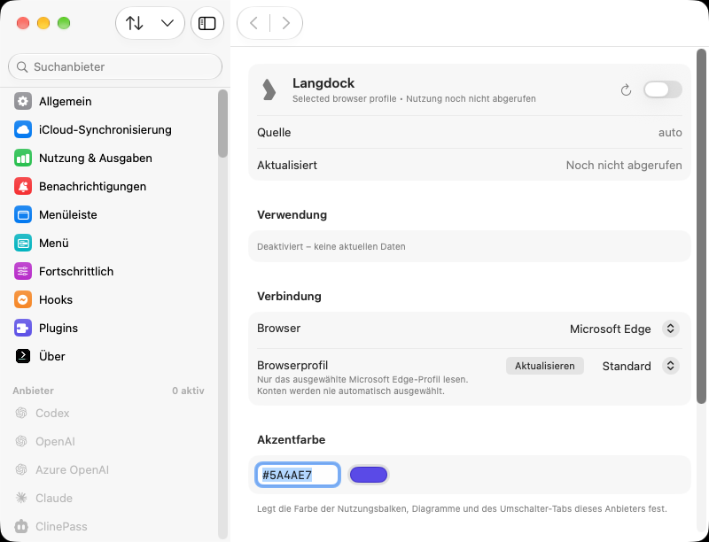
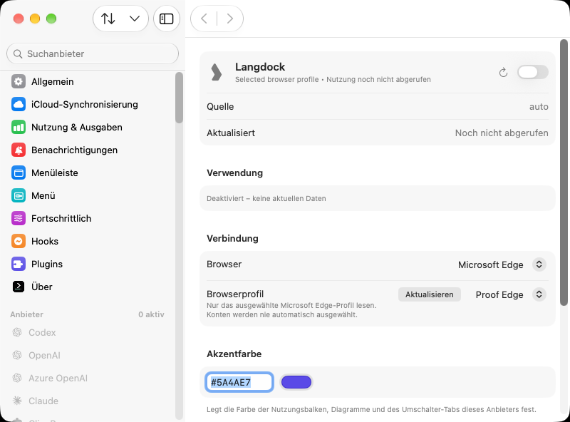
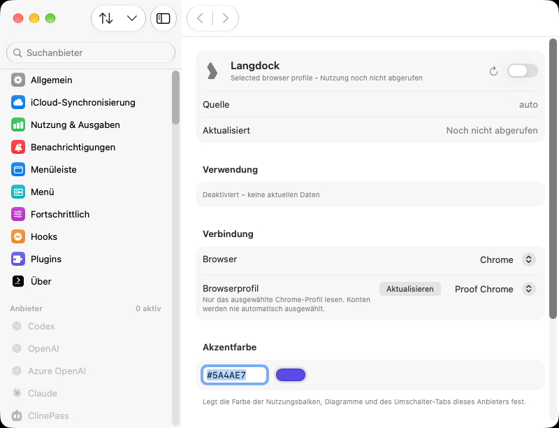
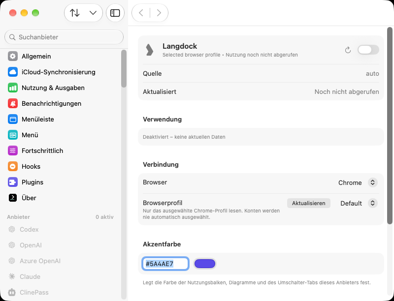

# PR #4911: native packaged-app profile label proof

This is permanent, sanitized evidence for [steipete/CodexBar#4911](https://github.com/steipete/CodexBar/pull/4911). It is kept on a separate evidence branch so the production patch stays unchanged.

[Successful GitHub-hosted run](https://github.com/dYn36/CodexBar/actions/runs/41681141363) · [Machine-readable results](result.json) · [Executed workflow](executed-workflow.yml)

## What actually ran

Two clean, separate source checkouts were packaged through the repository's normal command:

```sh
CODEXBAR_SIGNING=adhoc CODEXBAR_ALLOW_LLDB=0 ARCHES=arm64 ./Scripts/package_app.sh debug
```

- Base: `897bff31731bb4b21b105f6e8bf4c32a8a8bf095`.
- Head: `ac8e6a93d083f46b52984052317f425309d20894`.
- GitHub-hosted `xcode-27-arm64`, image `20261026.0314.1`; macOS 27.0.1 (26A434); Xcode 27.0 (27A266a); Apple Swift 6.4.
- Normal ad hoc debug bundles, no LLDB entitlement. Source trees stayed clean. The embedded Git commit, executable SHA-256 and code-directory hash were checked and recorded.
- XCTest launches the registered, freshly packaged `CodexBar.app`, checks its exact running bundle URL, sends Cmd+, and examines its real settings window. The app receives normal configuration, German language arguments and the existing explicit Keychain-disable flag.
- Neither the picker, a profile list, nor localized text is injected into the app.

## Inputs and observed behavior

Fixtures live at the ordinary Chrome and Microsoft Edge locations in the fresh VM home. Each contains `Default/Cookies`, `Default/Network/Cookies` and `Local State` with `profile.info_cache.Default.name`. The cookie files are placeholders; no records are read. Normal JSON configuration seeds the selected canonical profile path. All providers are disabled.

| Revision | Browser | Local State name | Visible profile value | Same value after actual app restart | Saved raw ID unchanged |
| --- | --- | --- | --- | --- | --- |
| Base | Edge | Proof Edge | **Standard** — desired name absent | yes, still defective | yes |
| Base | Chrome | Proof Chrome | **Standard** — desired name absent | yes, still defective | yes |
| Head | Edge | Proof Edge | **Proof Edge** | yes | yes |
| Head | Edge | Default, after rename | **Default**, literal in German UI | yes | yes |
| Head | Chrome | Proof Chrome | **Proof Chrome** | yes | yes |
| Head | Chrome | Default, after rename | **Default**, literal in German UI | yes | yes |

Each stage launches the same bundle twice, with an explicit termination and a different process ID. The controller verifies the selected raw browser/profile ID before and after each stage. The head's rename changes only Local State while the app is stopped, leaving its config unchanged.

The baseline tests deliberately assert the observed defect, so XCTest exits zero while `desiredVisible` is false. The head requires `desiredVisible` and `desiredVisibleAfterRestart` to be true. The JSON records both meanings separately. An independent read-only reviewer checked all six native images, their hashes, the result matrix and the stated scope; no conflicting findings were identified.

## Original native images

These are unchanged window PNGs exported as native XCTest attachments. Their byte counts and SHA-256 values match the in-test capture metadata. They were also inspected visually. No OCR success is claimed.

### Edge: before



### Edge: after discovery



### Edge: after rename to Default


### Chrome: before


### Chrome: after discovery



### Chrome: after rename to Default



## Scope and restoration

This proves the normal filesystem discovery-to-rendering path of the real packaged app, using synthetic browser metadata. No real browser, account, cookie import or live Langdock request is involved. Selection is seeded through the normal config, not by a picker click. The rename happens between app processes, not while an open picker is being observed. Only the first launch of each stage has an image; the second has UI assertions and the recorded process/ID comparisons. The condensed JSON publishes comparison booleans, not individual PIDs or raw IDs. The Default image alone could also match a directory-name fallback; the initial saved-name images and separate metadata rename regression provide the complementary discovery evidence.

The hosted run verified its app and test processes stopped, its own bundle registrations were removed, and its app/defaults, browser fixture and plugin directories were removed. New parent directories were removed only if previously absent and still empty. Both external-state and final owned-root cleanup passed. No Keychain entries or macOS permissions were changed.

The user's Mac had no app/browser launches, GUI control, settings changes or credential reads during this remote run. Its installed Production app was not part of the test.

The temporary workflow and its eight temporary commits were removed from the PR branch using an exact expected-head lease after confirming they changed only that workflow. The PR source head remains the tested `ac8e6a93d083f46b52984052317f425309d20894`. This evidence branch intentionally retains only the sanitized technical record; the remote test environment and local capture staging are disposable.

## Reproduction

The workflow is archived under `executed-workflow.yml` so this evidence branch does not itself schedule runs. It requires a fresh GitHub-hosted macOS runner; its guards reject other runner types and preexisting test state. It packages the exact public source commits above, uses the real app and ordinary filesystem/config inputs, exports bounded hash-bound native screenshots, and verifies restoration. Do not run its preparation or cleanup against an existing user environment.
